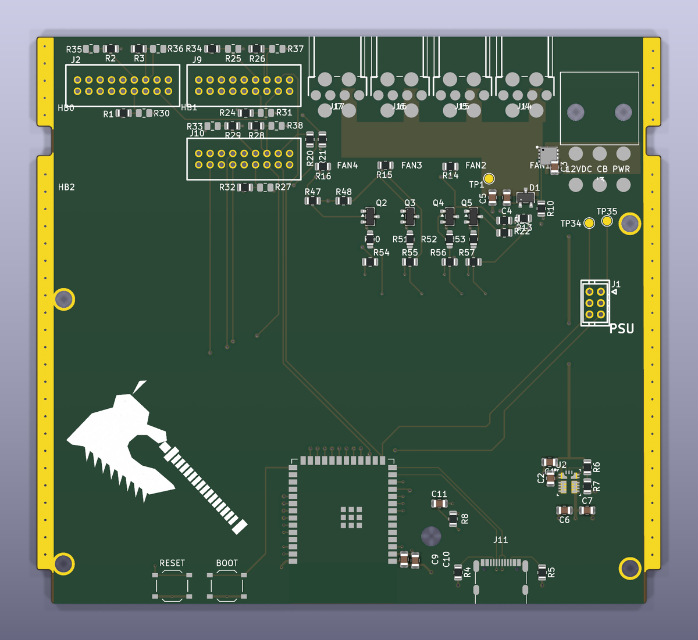
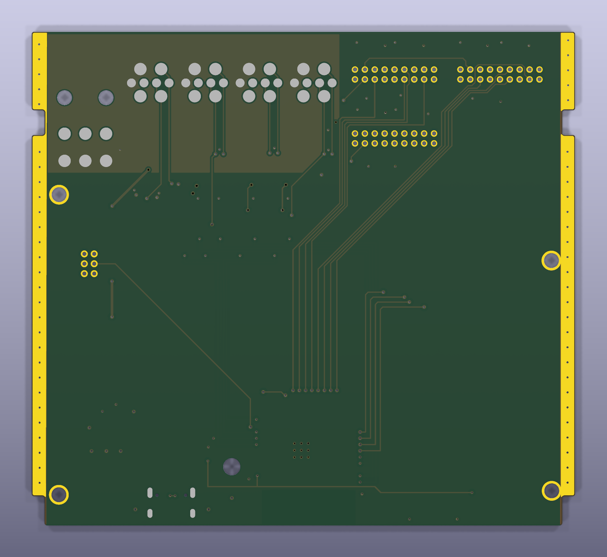

# ChainAxe

ESP32-S3 replacement control board for Antminer S19 hashboards. It drops into the stock
control-board position: the outline, mounting holes and connector positions follow a measured
drawing of the original S19 controller, and it talks to up to three hashboards over the standard
18-pin data cables.

## Board at a glance

- 110 x 100 mm, 4 layers, 1.6 mm, ENIG
- ESP32-S3-WROOM-1 (N16R8); console and flashing over native USB-C
- 3 hashboard data headers (2x9, 2.0 mm), one ESP32 UART each, plus shared I2C
- 4 fan headers (4.2 mm 2x2, or 2.54 mm 4-pin), PWM driven directly from the ESP32 and tach
  read back through PCNT
- 12 V input with reverse protection; 12 V fan bus and ground return as copper pours
- Antminer PSU control header (I2C + PSU_EN)
- On-board 3.3 V from a TPSM861253 buck module
- RESET and BOOT buttons for development

Full pinout, GPIO map and design notes: [boards/chainaxe/README.md](boards/chainaxe/README.md).

## Repository layout

| Path | What |
|---|---|
| `boards/chainaxe/` | KiCad project (schematic, PCB, local symbol and footprint libraries) |
| `mfg/assembly/` | BOM and pick-and-place files for assembly |
| `extra/outline/` | Measured S19 control-board drawing and the board outline DXF |
| `extra/axe_logo/` | Generator for the chainaxe silkscreen icon |
| `extra/scripts/` | Helper scripts used while building the board |
| `docs/images/` | Board renders |

## Bottom

## Credits and licences

Derived from [skot/bitcrane](https://github.com/skot/bitcrane) (GPL-3.0) for the hashboard
interface and [bitaxeorg/BitaxeGT](https://github.com/bitaxeorg/BitaxeGT) (CERN-OHL-S-2.0) for
the ESP32-S3 section. Keep both licences in mind when sharing or modifying the design.
